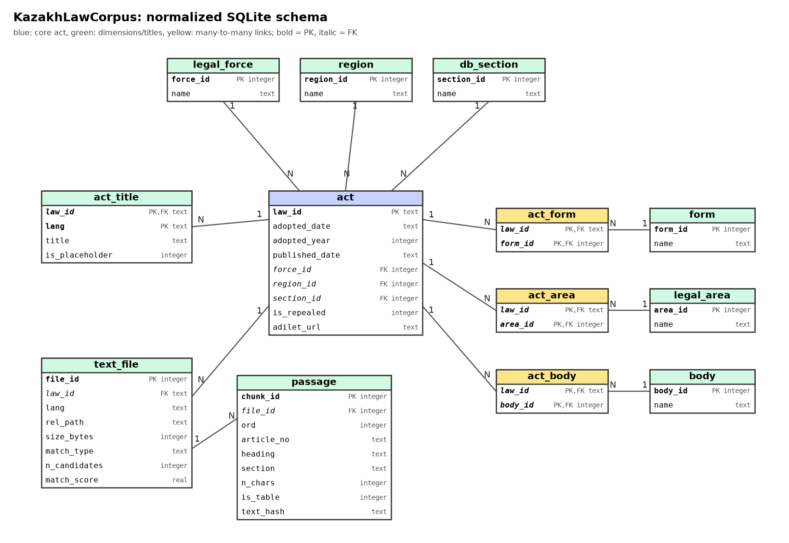

# Многоязычный поиск по законодательству Республики Казахстан

Итоговый проект по курсу «Programming for Data Analysis and Database», тема 16 «Kazakh Legal Search Engine» с расширением.
По вопросу на **казахском, русском или английском** языке система находит статьи кодексов и законов, которые на него отвечают,
и даёт ссылку на акт на adilet.zan.kz.



## Что сделано

- Метаданные 223 245 актов (KazakhLawCorpus) связаны с полными текстами ~204 тыс. файлов действующего законодательства (набор Mendeley), тексты нарезаны на 3,08 млн фрагментов.
- Данные загружены в нормализованную базу SQLite: 13 таблиц, ER-диаграмма, 13 SQL-запросов (CTE, JOIN, HAVING, оконные функции).
- Сравнены ключевые слова, TF-IDF, BM25 (три варианта обработки слов) и плотный поиск на e5-small, e5-base и bge-m3, а также гибрид; для английских запросов — прямой кросс-языковой поиск и перевод запроса.
- Тестовый набор: 53 информационные потребности × 3 языка = 159 запросов, 376 оценённых статей.
- Демо-приложение (веб-страница на встроенном HTTP-сервере Python, без дополнительных библиотек), отчёт и презентация (`report/`).

Главный результат (доля вопросов, у которых нужная статья среди первых 10 результатов, индекс по 230 545 фрагментам статей, 45 вопросов на язык):

| Система | русский | казахский | английский |
|---|---|---|---|
| BM25 | 0,42 | 0,31 | не поддерживает |
| e5-small | 0,58 | 0,49 | 0,24 |
| e5-base | 0,67 | 0,36 | 0,13 |
| **bge-m3** | **0,80** | **0,73** | **0,71** |

Результаты **предварительные**: оценки статей составлены автором с помощью ИИ-ассистента и не проверены независимо, набор оценок неполон,
доверительные интервалы около ±0,1. Подробности и ограничения: [docs/results_retrieval.md](docs/results_retrieval.md), отчёт в `report/`.

## Требования

| | |
|---|---|
| Python | 3.12 |
| Диск | около 9 ГБ под `data/` после полного запуска (из них 8 ГБ — тексты и архивы) |
| Память | 16 ГБ ОЗУ |
| Видеокарта | NVIDIA с 4 ГБ памяти для кодирования эмбеддингов (проверено на RTX 3050 Laptop); без неё кодирование на порядок медленнее |
| Прочее | 7-Zip (или `unrar`) для распаковки архивов; LibreOffice только для PDF-версий отчёта и слайдов |

Проект разрабатывался и проверялся на Windows 11; команды ниже работают и в PowerShell, и в bash (в PowerShell переменные задаются как
`$env:ИМЯ="значение"`). Скрипты читают и пишут UTF-8; в консоли Windows задайте `PYTHONUTF8=1`.

## Установка

```bash
python -m venv .venv
.venv\Scripts\activate            # Linux/macOS: source .venv/bin/activate
pip install -r requirements.txt
```

`requirements.txt` ставит PyTorch с CUDA 13. Для CPU удалите две первые строки с `torch` и выполните `pip install torch`.
Модели (bge-m3 ≈ 2,3 ГБ, e5-small и e5-base, для перевода запросов NLLB-600M ≈ 2,4 ГБ) скачиваются с Hugging Face при первом использовании.
Для пересборки отчёта и слайдов: `pip install -r requirements-report.txt`.

## Проверка за пару минут

```bash
python -m pytest tests -q        # 21 тест: нарезка текста, поисковый модуль и сервер
```

## Данные

```bash
python src/00_download_data.py
```

Скрипт скачивает и проверяет (SHA-256) данные и распаковывает тексты; повторный запуск пропускает уже готовое.

| Источник | Что | Лицензия |
|---|---|---|
| [KazakhLawCorpus](https://huggingface.co/datasets/Arailym-tleubayeva/KazakhLawCorpus) | `laws_metadata.csv`: метаданные 223 245 актов | Apache 2.0 |
| [Textual Foundations of Justice](https://data.mendeley.com/datasets/jdpc5658nh) | тексты действующих актов на 01.04.2024: 102 596 файлов ru и 101 304 kk | CC BY 4.0 |
| [adilet.zan.kz](https://adilet.zan.kz) | только ссылки на акты; страницы не скачиваются | — |

## Воспроизведение конвейера

Скрипты нумерованы по порядку запуска; все команды выполняются из корня проекта. Время — на ноутбуке с RTX 3050 (4 ГБ), 16 ГБ ОЗУ, 16 потоков.

| Шаг | Команда | Что делает | Время |
|---|---|---|---|
| 1 | `python src/01_csv_to_parquet.py` | CSV 952 МБ → Parquet 30 МБ (блоками по 100 тыс. строк) | 5 с |
| 2 | `python src/05_link_texts.py` | связывает файлы Mendeley с актами → `data/processed/act_text_link.parquet` | 1 мин |
| 3 | `python src/08_build_db.py` | база `data/processed/legal.db` по схеме `sql/schema.sql` | 30 с |
| 4 | `python src/12_build_chunks.py` | нарезка текстов на фрагменты → `chunks_ru.parquet`, `chunks_kk.parquet` | 5 мин |
| 5 | `python src/14_load_passages.py` | метаданные фрагментов в таблицу `passage` | 2 мин |
| 6 | `python src/21_build_index_docs.py` | таблица документов поиска (без таблиц и дублей) | 1 мин |
| 7 | `python src/24_embed.py BAAI/bge-m3 articles 384` | эмбеддинги 230 545 статей (возобновляемо по частям) | 62 мин |
| 8 | `python src/36_build_extra_articles.py` | статьи, пропущенные нарезкой из-за заголовков без точки («Статья 1»: Конституция, многие договоры): 88 тыс. фрагментов | 1 мин |
| 9 | `python src/37_embed_extra.py` | эмбеддинги этих статей | 17 мин |
| 10 | `python src/33_build_app_data.py` | компактные таблицы и индексы BM25 для приложения | 1 мин |
| 11 | `python src/34_embed_titles.py` | эмбеддинги 439 124 названий актов | 20 мин |

После шагов 1–11 работает приложение. Остальное нужно для сравнения методов:

| Что | Команда |
|---|---|
| Эмбеддинги других моделей | `python src/24_embed.py intfloat/multilingual-e5-small articles 384`; то же для `intfloat/multilingual-e5-base` (9 и 27 мин); `... e5-small all 384` — весь корпус, 1,3 ч |
| Перевод английских запросов (результат уже лежит в `annotation/queries_en_translated.json`) | `python src/26_translate_queries.py` |
| Оценка BM25, TF-IDF, ключевых слов | `QRELS_VERSION=v1 python src/22_sparse_experiments.py --scope articles` (и `--scope all --modes stem --langs ru`, `--modes p5 --langs kk`) |
| Оценка плотного поиска и гибрида | `QRELS_VERSION=v1 python src/25_dense_eval.py BAAI/bge-m3 articles` (аналогично для остальных моделей) |
| Поиск акта по названию | `python src/27_title_eval.py` |
| Парное сравнение BM25 и bge-m3, разбор ошибок | `python src/35_paired_analysis.py`, `python src/28_error_analysis.py` |
| SQL-запросы и ER-диаграмма | `python src/09_run_queries.py` (результаты в `outputs/sql/`), `python src/10_er_diagram.py` |
| Сводка результатов | `python src/29_make_report.py` → `docs/results_retrieval.md` |
| Отчёт и слайды | `python report/make_figures.py`, `python report/build_report.py`, `python report/build_slides.py`; снимки приложения (при запущенном приложении и установленном Edge): `python report/capture_screens.py` |

`QRELS_VERSION` выбирает набор оценок: `v1` — текущий, `v0` — первоначальный; файлы результатов версии v1 имеют суффикс `_v1`.
Остальные файлы в `src/` — диагностика, использованная при разработке (профилирование полей, проверка связки, просмотр кандидатов).

## Приложение

```bash
python app/server.py
```

Режимы: поиск по статьям (смысловой bge-m3, BM25 или гибрид), поиск акта по названию, сравнение методов; фильтры по статусу, виду акта и году. Настройки находятся в панели справа; в блоке «Примеры запросов» собраны все 53 вопроса тестового набора на каждом языке. Запрос со ссылкой на статью («статья 1 Конституции РК», «ст. 188 УК», «52-бап») показывает эту статью первой.
Первый запуск загружает индексы и модель около минуты, дальше ответ приходит за 1–4 секунды на GPU. Описание: [app/README.md](app/README.md).
Нужны данные шагов 1–11.

## Тестовый набор и оценка

| Файл | Содержимое |
|---|---|
| `annotation/needs.json` | 53 информационные потребности на трёх языках |
| `annotation/queries.jsonl` | 159 запросов |
| `annotation/qrels_v0.json`, `qrels_v1.json` | оценки статей: 102 (v0) и 376 (v1) |
| `annotation/pool_round2.json` | кандидаты второго раунда, собранные из восьми прогонов систем |
| `annotation/review.html` | страница для независимой проверки оценок (сохраняет прогресс в браузере, результат выгружается в JSON) |
| `docs/annotation_guidelines.md` | правила разметки |

Оценка относится к паре «акт, статья»; версии и проекты одного акта объединяются сравнением хеша текста; метрики — Success@k, Recall@50, MRR@10, nDCG@10 с бутстрэпом (см. `src/evaluate.py`).

## Структура

```
src/          конвейер (скрипты 00–35) и библиотеки: chunking.py, textproc.py, search_lib.py, evaluate.py, annotation_tools.py
app/          веб-приложение: engine.py (поиск), server.py (HTTP-сервер), static/index.html (страница)
sql/          схема базы и 13 запросов
annotation/   тестовый набор: потребности, запросы, оценки
tests/        автоматические тесты
docs/         результаты, ER-диаграмма, правила разметки, состояние проекта (STATE.md)
outputs/      результаты экспериментов (JSON) и SQL-запросов (CSV)
report/       отчёт и презентация (docx/pptx/pdf) и скрипты их сборки
data/         данные и индексы (в репозиторий не входят, строятся шагами выше)
```

## Ограничения

- Оценки не проверены независимо, казахские формулировки запросов нужно проверить носителю языка; метрики занижены из-за неполноты оценок.
- Поиск охватывает статьи кодексов и законов; акты без деления на статьи в основной индекс не входят. Тексты — на 01.04.2024.
- Около 20% файлов не привязаны к конкретному акту; bge-m3 на всём корпусе (1,7 млн фрагментов, около 9 часов) не запускался.
- Ссылка ведёт на акт целиком, не на статью. Система справочная и не заменяет юридическую консультацию.

## Источники и цитирование

- Tleubayeva A., Mansurova A., Shomanov A., Makhambetova Z., Boluk P. S. KazakhLawCorpus: A Large-Scale Metadata Corpus for Kazakh Legislation. *Data*, 2026, 11(9), 217. doi:10.3390/data11090217.
- Akhmetov I., Zhamankhan A., Zhetesov N., Kubaeva A. Textual Foundations of Justice: Kazakhstani laws and jurisprudence dataset. Mendeley Data, V3, 2024. doi:10.17632/jdpc5658nh.3.

Лицензия кода: [не указана].
